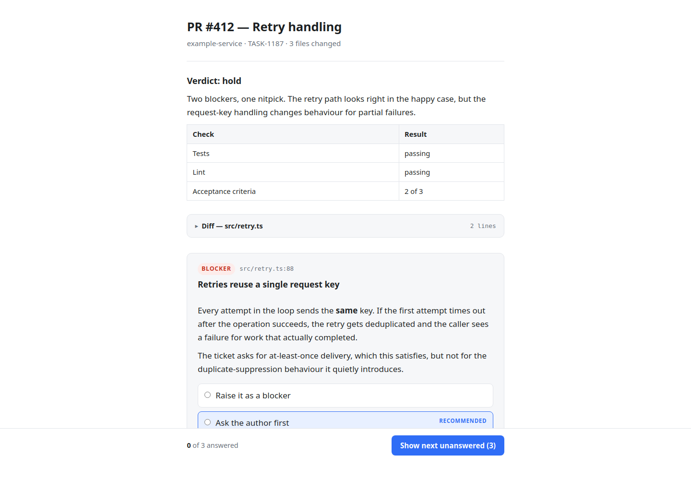
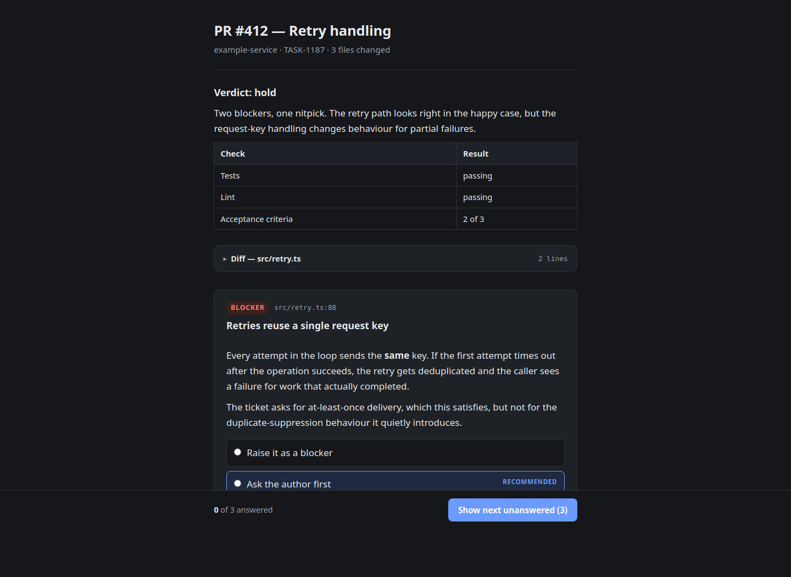
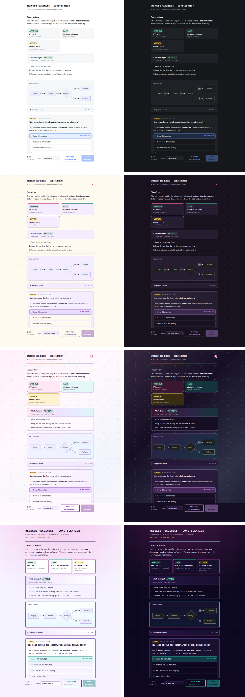

# viz

`viz` turns structured output from CLI tools and coding agents into readable
browser pages. It can also collect decisions and return the answers to the
calling command.

The calling tool emits JSON. `viz` owns the HTML, styling, browser interaction,
and answer collection.

## Why?

Because LLMs are constantly throwing walls of text at your terminal and it can be hard to parse and is mentally draining.  Adding some visuals to the AI back and forth helps to break up the monotony. 

## Screenshots

<details>
<summary>View light and dark examples</summary>

### Light mode



### Dark mode



</details>

## Install

Requires Node 22.18 or newer. Node runs the TypeScript directly, so there is no
build step.

```bash
git clone https://github.com/jordanmarchetto/viz.git
cd viz
npm install
npm link
```

`npm link` adds the `viz` command to your `PATH`.

## Quick start

Render a page and open it in your browser:

```bash
echo '{"title":"Hello","blocks":[{"type":"md","text":"# Hello from viz"}]}' \
  | viz --open
```

`viz` writes a self-contained HTML file, opens it, prints its `file://` URL, and
exits. Without `--open`, it only prints the link.

Render the built-in sample page without providing JSON:

```bash
viz test --open
```

The test page includes representative content, a Mermaid diagram, and a detached
decision. It accepts normal options, such as `viz test --theme random_dark`.

## Add some whimsy with themes

Keep the original focused design with `classic`, or switch to the warm
`storybook`, pastel-rainbow `unicorn`, neon `arcade`, full-spectrum `rainbow`,
photocopied-punk `zine`, storybook `high-fantasy`, ink-and-parchment
`adventurer-handbook`, gothic `inferno`, grim `dark-cathedral`, muddy fairy-tale
`swamp`, or tactical `space-command` themes. Themes can follow the system, provide fixed light or dark
appearances, or define an independent visual world:

```bash
viz --theme unicorn --detach --open < examples/theme-showcase.json
viz --theme arcade --detach --open < examples/theme-showcase.json
viz --theme rainbow --detach --open < examples/theme-showcase.json
viz --theme zine --detach --open < examples/theme-showcase.json
viz --theme high-fantasy --detach --open < examples/theme-showcase.json
viz --theme adventurer-handbook --detach --open < examples/theme-showcase.json
viz --theme inferno --detach --open < examples/theme-showcase.json
viz --theme dark-cathedral --detach --open < examples/theme-showcase.json
viz --theme swamp --detach --open < examples/theme-showcase.json
viz --theme space-command --detach --open < examples/theme-showcase.json
viz --theme random_light --detach --open < examples/theme-showcase.json
viz --theme random_dark --detach --open < examples/theme-showcase.json
viz --theme random_system --detach --open < examples/theme-showcase.json
```

<details>
<summary>View all theme appearances</summary>



</details>

Run `viz themes` to list available choices. Adaptive named themes follow your
system mode; independent themes such as `rainbow` use their own appearance. Set
a default with `viz config theme storybook`; `--theme` and `VIZ_THEME` override
it for one invocation. `random` includes every design. The mode-specific random
choices select only compatible themes. Every generated page also includes a
footer selector for switching the current page without reloading or changing
the configured default. See the [themes guide](docs/themes.md) for configuration,
selection behavior, and full-size screenshots.

## Collect answers

Add a `decide` block when the calling tool needs an answer:

```bash
viz --open <<'VIZ'
{
  "title": "Retry behavior",
  "blocks": [
    {
      "type": "decide",
      "id": "retry",
      "title": "How should retries behave?",
      "options": ["Reuse the request key", "Generate a new key"],
      "recommend": "Reuse the request key"
    }
  ]
}
VIZ
```

`viz` waits for the browser submission and then prints the answer to stdout:

```text
retry: Reuse the request key
```

The page content determines the default mode:

| Page contains | Mode | Behavior |
|---|---|---|
| Display blocks only | Detached | Render, print a link, and exit |
| Any `decide` block | Blocking | Serve locally, wait for submit, and print answers |

Use `--detach` or `--wait` to override the inferred mode. A detached page with
decisions provides a **Copy answers** button instead of submitting them. After
you answer at least one decision, you can submit or copy that partial set without
answering every block.

## Teach an LLM to use viz

Add `viz` guidance to an agent's system prompt, repository instructions, or
skill file. Tell the agent:

- When a browser page is more useful than normal terminal output.
- To use `viz --detach` for reports and reference pages.
- To use blocking `viz` only when it must wait for the user's decisions.
- To place large files and diffs in `ref` blocks instead of copying them into
  the JSON.
- To fall back to normal output when `viz` is unavailable.

The [LLM integration guide](docs/agent-integration.md) provides a complete
instruction block you can copy into an agent or skill, plus examples for
detached reports and blocking decision pages.

## Documentation

- [Page format](docs/page-format.md): All block types and their fields.
- [Themes](docs/themes.md): Built-in themes, selection, configuration, and screenshots.
- [Teach an LLM to use viz](docs/agent-integration.md): Agent instructions,
  mode selection, fallbacks, and examples.
- [CLI reference](docs/cli-reference.md): Options, output, saved pages, and
  environment variables.
- [Remote pages](docs/remote-pages.md): Optional `viz-server` configuration and
  SSH usage.
- [Development](docs/development.md): Project layout and local checks.
