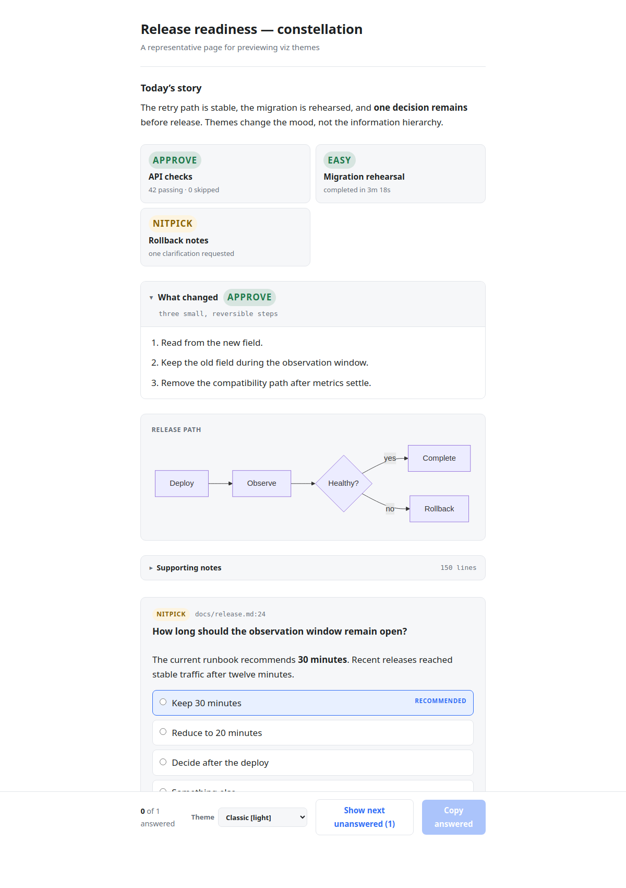
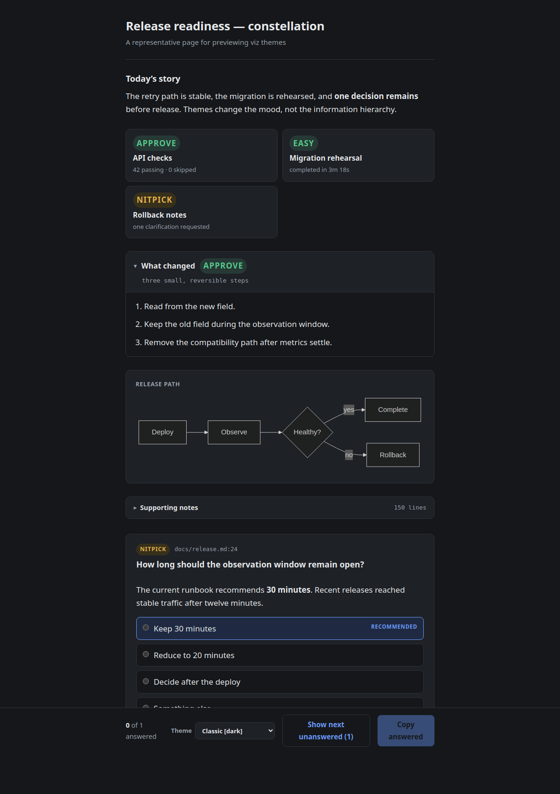
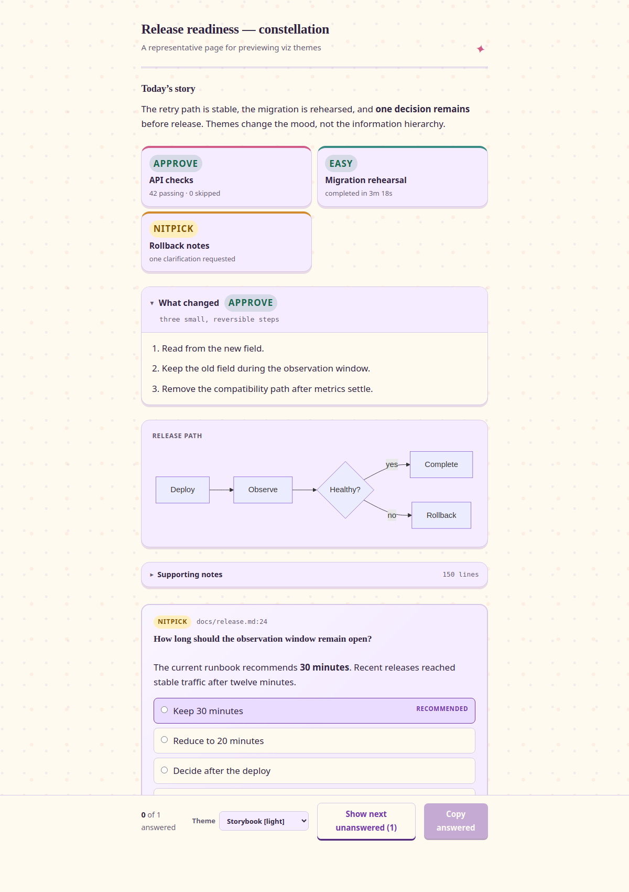
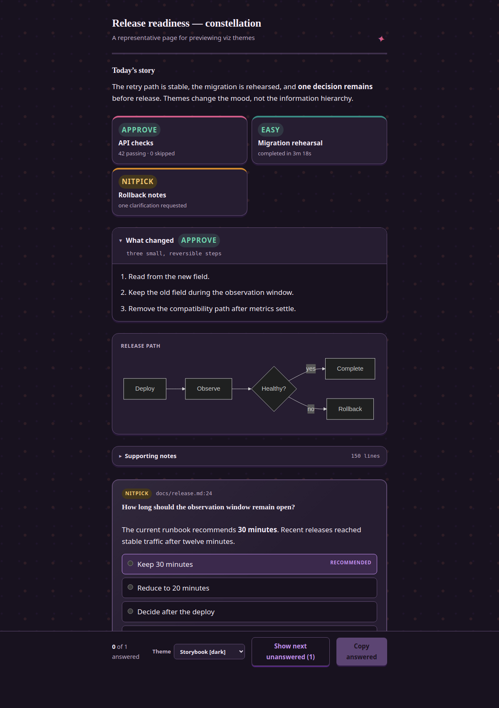
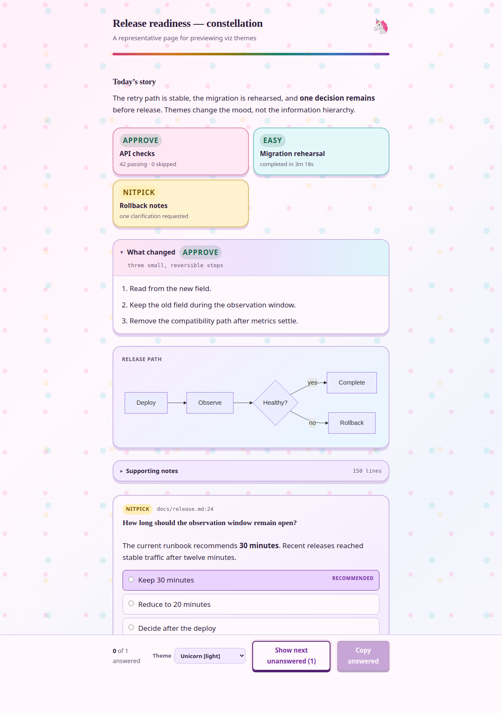
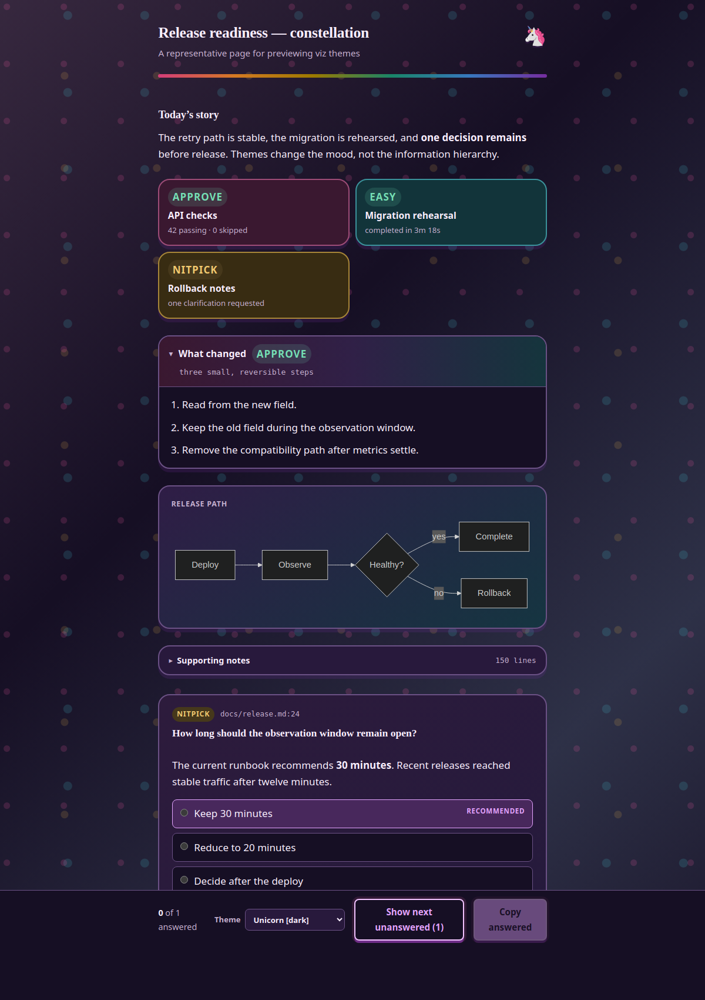
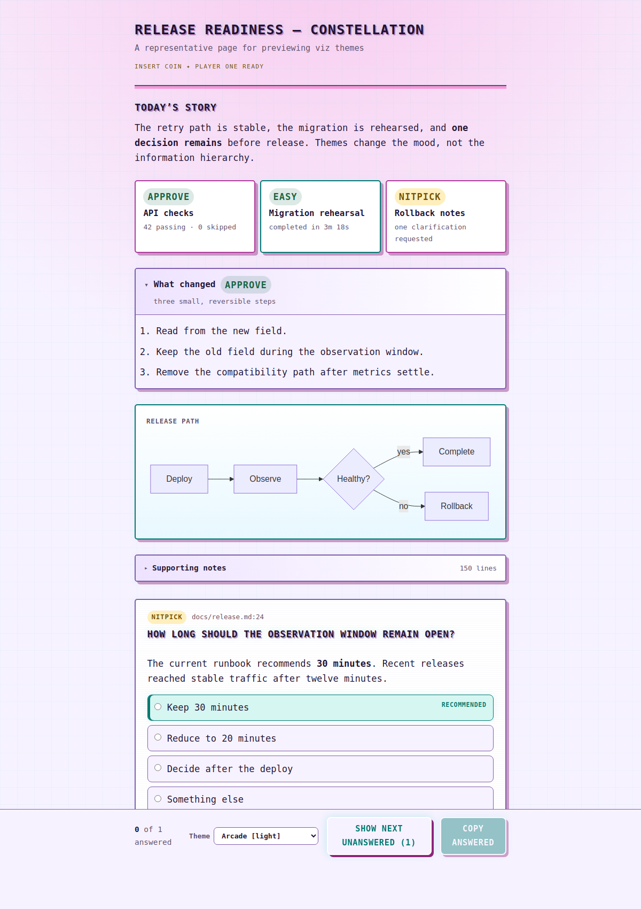
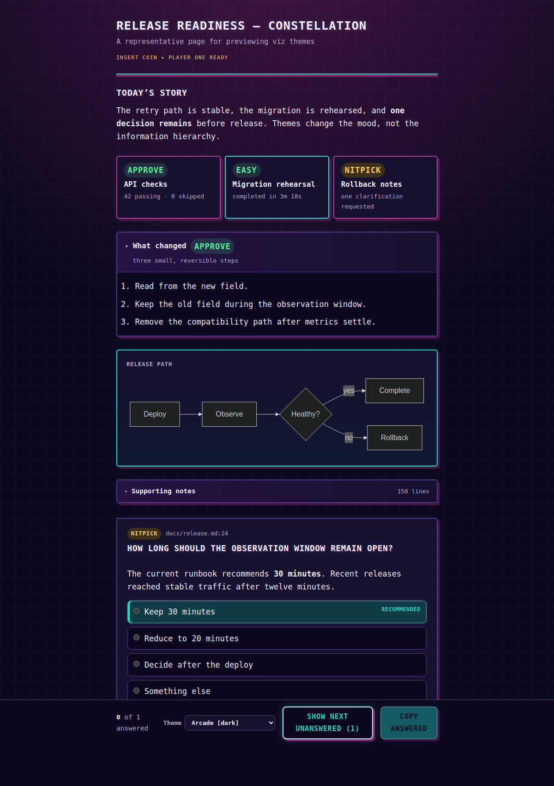

# Themes

Themes change the visual world around page content. The page format and controls
remain functional, but a theme may change palettes, typography, spacing, block
shape, and composition. Generated pages remain self-contained and use CSS-only
decoration.

## Built-in themes

| Theme | Color behavior | Description |
|---|---|---|
| `classic` | Follows the system | The original quiet, focused viz design |
| `storybook` | Follows the system | Warm paper, violet ink, and a little narrative sparkle |
| `unicorn` | Follows the system | Pastel rainbows, candy-colored cards, and one tiny unicorn |
| `arcade` | Follows the system | A neon cabinet for shipping software at high score |
| `rainbow` | Independent | Bold color fields that give every content block its own stage |
| `zine` | Independent | Photocopied punk collage with fluorescent cut-paper blocks |
| `high-fantasy` | Independent | An emerald road through old maps, golden halls, and cheerful quests |
| `adventurer-handbook` | Independent | An ink-and-parchment adventurer's manual with red rulebook accents |
| `inferno` | Independent | Charred cathedral stone, blood-red glass, and living embers |
| `dark-cathedral` | Independent | A grim reliquary of iron, bone, blood-red glass, and forbidden rites |
| `swamp` | Independent | A muddy fairy-tale swamp of onions, crooked signs, and ogre-green cheer |
| `space-command` | Independent | Deep-space command deck with cyan tactical readouts |
| `random` | Uses the chosen theme's behavior | Chooses from every theme, including independent themes |
| `random_light` | Light | Chooses from themes that provide a light appearance |
| `random_dark` | Dark | Chooses from themes that provide a dark appearance |
| `random_system` | Follows the system | Chooses from themes that follow system-mode changes |

List the themes available in your installed version:

```bash
viz themes
```

## Choose a theme

Select a theme for one invocation:

```bash
viz --theme storybook --open < examples/theme-showcase.json
viz --theme unicorn --open < examples/theme-showcase.json
viz --theme arcade --open < examples/theme-showcase.json
viz --theme rainbow --open < examples/theme-showcase.json
viz --theme zine --open < examples/theme-showcase.json
viz --theme high-fantasy --open < examples/theme-showcase.json
viz --theme adventurer-handbook --open < examples/theme-showcase.json
viz --theme inferno --open < examples/theme-showcase.json
viz --theme dark-cathedral --open < examples/theme-showcase.json
viz --theme swamp --open < examples/theme-showcase.json
viz --theme space-command --open < examples/theme-showcase.json
viz --theme random --open < examples/theme-showcase.json
viz --theme random_light --open < examples/theme-showcase.json
viz --theme random_dark --open < examples/theme-showcase.json
viz --theme random_system --open < examples/theme-showcase.json
```

Set a default:

```bash
viz config theme storybook
viz config show
```

Remove the configured default:

```bash
viz config theme disable
```

You can also edit `~/.config/viz/config.json` directly:

```json
{
  "theme": "storybook"
}
```

Theme selection uses this precedence:

1. `--theme`
2. `VIZ_THEME`
3. The `theme` value in the config file
4. `classic`

An unknown theme fails with the valid choices instead of silently falling back.
Every random choice resolves once, so the local archive and remote page from one
invocation always match.

`random_light` and `random_dark` select only themes that provide the requested
appearance. `random_system` selects only adaptive themes. Bare `random` selects
from every theme and keeps the selected theme's normal color behavior.

## Theme appearance types

A theme can provide either or both of the standard `light` and `dark`
appearances. It can instead provide an `independent` appearance that does not
claim to be either one.

An adaptive theme opens in `system` mode and follows operating-system changes.
This policy is separate from its concrete light and dark appearances. An
independent theme ignores operating-system color-mode changes and owns its full
visual treatment.

Themes may override the shared component styles, not only palette variables.
This allows distinct typography, spacing, borders, backgrounds, and block
composition while preserving the page's content and interactions. Themes may
also bundle curated image assets. The renderer embeds those images as data URLs,
so local and remote pages remain self-contained and do not depend on third-party
hosts. Themes can provide several artwork arrangements. `viz` chooses one per
invocation and reuses it for the local, remote, and archived copies.

## Switch themes in an open page

Every page has a **Theme** selector in its bottom bar. Standard appearances show
labels such as `Classic [light]` and `Arcade [dark]`. Independent themes use one
plain label, such as `Rainbow`.

Choose an appearance or **Surprise me**. Surprise me picks another theme and
preserves the current light or dark appearance when the destination supports
it. When it does not, the destination uses its independent or default
appearance. The page updates without reloading, so selected answers, notes,
focus, and scroll position remain intact.

The selector changes only the open page. It does not modify CLI configuration or
remember a browser preference. Choosing a concrete light or dark appearance
stops that page from following operating-system changes.

Mermaid diagrams rerender for the active theme. If a diagram cannot rerender,
its existing rendering remains visible.

The bottom bar stays available on display-only and decision pages, wraps on
narrow screens, and is omitted from browser printouts.

## Readability and interaction

Content blocks remain visibly distinct so readers can scan the page. Themes may
use expressive color combinations and are not required to satisfy a single
contrast formula. Keep text comfortably readable for the intended treatment.

Semantic HTML, keyboard interaction, safe links, answer collection, and reduced
motion behavior remain shared responsibilities. Generated pages embed all
built-in themes so switching works in saved `file://` pages without another
network request.

## Screenshots

### Classic




### Storybook




### Unicorn




### Arcade




### Rainbow

Use `viz --theme rainbow --open < examples/theme-showcase.json` to preview its
independent appearance.

### Zine

Use `viz --theme zine --open < examples/theme-showcase.json` to preview its
independent appearance.

### High Fantasy

Use `viz --theme high-fantasy --open < examples/theme-showcase.json` to preview
its independent appearance.

### Adventurer Handbook

Use `viz --theme adventurer-handbook --open < examples/theme-showcase.json` to preview
its independent appearance.

### Inferno

Use `viz --theme inferno --open < examples/theme-showcase.json` to preview its
independent appearance.

### Dark Cathedral

Use `viz --theme dark-cathedral --open < examples/theme-showcase.json` to preview
its independent appearance.

### Swamp

Use `viz --theme swamp --open < examples/theme-showcase.json` to preview its
independent appearance.

### Space Command

Use `viz --theme space-command --open < examples/theme-showcase.json` to preview
its independent appearance.
